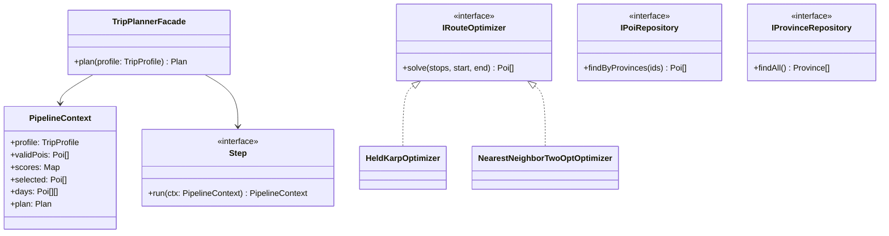

# Đặc tả pipeline lập lịch trình (spec.md)

Tác giả: A · Giai đoạn 1 · Trạng thái: Đợi D duyệt

## 1. Đầu vào của planner

Planner nhận hai thứ: `TripProfile` (câu trả lời Q1–Q14) và dữ liệu đã được Repository đọc từ `data/`.

```js
/**
 * @typedef {Object} TripProfile
 * @property {number} days              Q1: 1 đến 14
 * @property {string} startDate         Q1: YYYY-MM-DD
 * @property {number} budgetVnd         Q2: ngân sách trần, VND
 * @property {string[]} provinceIds     Q3: mã tỉnh đã mở khoá
 * @property {string[]} interests       Q5: tối đa 3 (nature, culture, food, beach, ...)
 * @property {string[]} groupTypes      Q4: solo, couple, friends, family, children, seniors, pets
 * @property {number} headcount         Q4
 * @property {"relaxed"|"balanced"|"packed"} pace   Q6, mặc định balanced
 * @property {string[]} mustVisit       Q14: poi id
 * @property {string[]} mustAvoid       Q14: poi id
 * @property {string[]} accessibility   Q11: wheelchair, limited-walking, stroller, none
 */
```
##### Phóng màn to hết cỡ để mấy cái bảng ko bị lỗi

## 2. Pipeline tám bước

Mỗi bước là một `Step` nhận `PipelineContext`, đọc đầu vào của mình và ghi đầu ra vào context. Bước sau chỉ đọc đầu ra của bước trước.

| # | Bước     | Nhận                                  | Trả                                       | Ràng buộc chính                                    |
|---|----------|---------------------------------------|-------------------------------------------|----------------------------------------------------|
| 1 | Filter   | POI của các tỉnh đã chọn, profile     | `validPois`                               | Loại POI vi phạm ràng buộc cứng (mục 3)            |
| 2 | Score    | `validPois`, profile, context tháng   | `scores: Map<poiId, number>` trong [0, 1] | Công thức Score(p), mục 4                          |
| 3 | Select   | `scores`, số giờ khả dụng             | `selected`                                | 0/1 knapsack, mục 5                                |
| 4 | Group    | `selected`, số ngày                   | `days: Poi[][]`                           | Chia theo khoảng cách, trần di chuyển mỗi ngày     |
| 5 | Order    | một ngày                              | thứ tự điểm                               | Bắt đầu và kết thúc tại lodging; `IRouteOptimizer` |
| 6 | Schedule | thứ tự một ngày                       | giờ đến và giờ đi từng điểm               | Trong giờ mở cửa; đệm theo nhịp Q6                 |
| 7 | Attach   | lịch đã có giờ                        | 11 thành phần lịch trình                  | Bữa ăn, lodging, y tế, dự phòng mưa                |
| 8 | Validate | plan hoàn chỉnh                       | `{ ok, violations[] }`                    | Plan không `ok` thì không bao giờ trả về           |

Nếu bước nào thất bại, chuỗi dừng và trả lỗi kèm mã (ví dụ `NO_FEASIBLE_SET`). Không tự nới ràng buộc cứng.

## 3. Bước 1: Filter

Một POI bị loại nếu vi phạm bất kỳ điều kiện nào sau:

- Thiếu trường bắt buộc theo BR 7.1 (`id`, `province_id`, `lat`, `lon`, `opening_hours`, `price_vnd`, `tags`, `last_verified`...).
- `province_id` không thuộc `provinceIds` của profile.
- Đóng cửa trong toàn bộ khoảng thời gian có thể đến thăm.
- Không có tuỳ chọn an toàn với dị ứng (Q9) khi POI là nhà hàng.
- Nằm trong `mustAvoid`.
- Vi phạm accessibility (ví dụ `difficulty: hard` khi có `wheelchair` hoặc `limited-walking`).
- Vi phạm an toàn nhóm: trẻ em loại địa điểm rủi ro cao; người cao tuổi loại dốc và bậc thang nhiều.

Không loại POI vì dữ liệu cũ. Giá hoặc giờ cũ hơn 12 tháng chỉ bị trừ điểm và gắn cờ (BR 11.2).

Ngày đi thứ i (i từ 1 đến `days`) có ngày dương lịch là `startDate + (i − 1)` ngày. Từ ngày đó lấy thứ trong tuần để tra `opening_hours`.

## 4. Bước 2: Score

Công thức:

Score(p) = wi·I(p) + wg·G(p) + ws·S(p) + wr·R(p) + wu·U(p) − wc·C(p)

Mỗi thành phần có miền giá trị [0, 1]:

| Ký hiệu | Tên                |                                            Cách tính đề xuất                                               | Nguồn                    |
|---------|--------------------|------------------------------------------------------------------------------------------------------------|--------------------------|
| I(p)    | Khớp sở thích      | Số tag khớp `interests` / số `interests` đã chọn                                                           | `pois.tags`, Q5          |
| G(p)    | Khớp nhóm đi       | Tra quy tắc nhóm (BR 5.2), chuẩn hoá về [0, 1]                                                             | `pois.tags`, Q4          |
| S(p)    | Mùa và thời tiết   | Tra `context.json` theo (tỉnh, tháng); nhân hệ số mưa, bão, mùa cao điểm                                   | `context.json`, mục 6 BR |
| R(p)    | Độ phổ biến        | `popularity`                                                                                               | `pois.popularity`        |
| U(p)    | Ưu tiên người dùng | 1 nếu trong wishlist hoặc `mustVisit`, 0 nếu không                                                         | game và giao diện        |
| C(p)    | Chi phí            | `price_vnd / budgetPerPoi`, cắt về [0, 1]; `budgetPerPoi = budgetVnd / (days × poisPerDay(pace))` (mục 10) | `pois.price_vnd`         |

Ghi chú:

- Q10 (landmark) điều chỉnh `wr`: "yes" tăng, "no" giảm.
- Các trọng số w không điền giá trị. Quy tắc đã biết: tổng các w bằng 1 (BR 8.1). Giá trị sẽ điền ở giai đoạn 3 và lưu trong file cấu hình.
- Vì có dấu trừ, Score có thể âm. POI có Score ≤ 0 bị loại trước khi Select (mục 5).
- I(p): nếu interests rỗng thì I(p) = 1 cho mọi POI (không phạt, vì không có tiêu chí so khớp). Trường hợp này chỉ xảy ra khi dữ liệu lỗi, vì Q5 là bắt buộc.

## 5. Bước 3: Select

Bài toán: chọn tập POI có tổng Score lớn nhất, không vượt số giờ khả dụng.

- Trước khi đưa vào knapsack, loại mọi POI có Score ≤ 0.
- Sức chứa (capacity) = `days × số giờ hoạt động tối đa theo nhịp × 60` (đơn vị phút, mục 7).
- Trọng lượng (weight) của mỗi POI = `visit_minutes.short` (phút).
- Ngân sách không nằm trong knapsack. Tổng tiền được kiểm tra ở bước Validate (mục 8).
- Không chọn hai POI gần giống nhau cùng loại trong một ngày, trừ khi người dùng yêu cầu.

Quy hoạch động 0/1 knapsack với một chiều (thời gian):

```
dp[w] = max(dp[w], score[i] + dp[w - weight[i]])   duyệt w từ cao xuống thấp
```

## 6. Bước 4: Group

- Số cụm = số ngày của profile.
- Phân cụm k-means trên `(lat, lon)` với hạt giống cố định (đảm bảo tái lập, BR 9).
- Mỗi cụm phải có tổng di chuyển không vượt trần của nhịp (mục 7). Nếu vượt, tách hoặc chuyển POI sang ngày khác.
- Khoảng cách dùng haversine để lọc sơ bộ. Thời gian thực dùng ma trận thời gian đã có sẵn.

## 7. Bước 5 và 6: Order và Schedule

Order: tìm thứ tự ngắn nhất đi qua các POI, bắt đầu và kết thúc tại lodging.

- Từ 15 điểm trở xuống: Held-Karp (Bitmask DP), nghiệm tối ưu.
- Trên 15 điểm: Nearest Neighbor, sau đó 2-opt để cải thiện.
- Hai thuật toán cùng giao diện `IRouteOptimizer`, chọn theo số điểm (mẫu Strategy).

Schedule: duyệt theo thứ tự đã có, gán giờ đến và giờ đi.

- Nếu đến sớm hơn giờ mở cửa, chờ.
- Nếu đến muộn so với giờ đóng cửa, đánh dấu để bước Validate xử lý.
- Thêm đệm theo nhịp Q6.

Bảng tham số nhịp độ (BR 8.2, giá trị khởi đầu để nhóm hiệu chỉnh):

| Nhịp (Q6)           | POI/ngày | Đệm | Giờ hoạt động tối đa | Di chuyển tối đa/ngày |
|---------------------|----------|-----|----------------------|-----------------------|
| relaxed             | 2–3      | 25% | 7                    | 2 giờ                 |
| balanced (mặc định) | 3–4      | 20% | 9                    | 3 giờ                 |
| packed              | 5–6      | 15% | 11                   | 4 giờ                 |

## 8. Bước 7 và 8: Attach và Validate

Attach thêm 11 thành phần (BR mục 7): route, activities, food, lodging, transport, healthcare, budget, context, backup, practical guide, souvenirs. Mỗi điểm ngoài trời phải có phương án dự phòng.

Validate kiểm tra lại toàn bộ plan:

- Không vi phạm ràng buộc cứng nào.
- Không có điểm nào được lên lịch khi đã đóng cửa.
- Tổng chi phí không vượt ngân sách. Nếu vượt, bỏ POI có Score thấp nhất trong các ngày rồi kiểm tra lại.
- Mỗi ngày nằm trong giới hạn giờ và di chuyển.

Plan không đạt thì không được trả về người dùng (BR 8.3).

## 9. Giao diện và cấu trúc (JSDoc, không có interface thật)



## 10. Quyết định đã chốt

1. **Knapsack hai ràng buộc.** Chọn phương án (b): thời gian là sức chứa của knapsack, tiền được kiểm tra riêng ở Validate (mục 5 và 8). Hệ quả: plan có thể vượt ngân sách ở bước Select, nên Validate phải có bước sửa (bỏ POI có Score thấp nhất).
2. **Score âm.** Loại mọi POI có Score ≤ 0 trước khi Select.
3. **Ngày đi và giờ mở cửa.** Ngày thứ i = `startDate + (i − 1)` ngày, lấy thứ trong tuần để tra `opening_hours` (mục 3).
4. **Trần giá một POI.** Không có trần cứng riêng cho từng POI. Chi phí được phạt mềm qua C(p) trong Score. Tổng tiền chỉ được kiểm tra ở Validate. Mẫu số của C(p) là `budgetPerPoi = budgetVnd / (days × poisPerDay(pace))`, với poisPerDay là 2,5 (relaxed), 3,5 (balanced), 5,5 (packed).
5. **Tie-break** (BR 8.3): điểm cao hơn → rating cao hơn → giá thấp hơn → `id` (so sánh theo `id` để kết quả không phụ thuộc vào dấu tiếng Việt).

Mục 4 đã dùng công thức C(p) với `budgetPerPoi` ở trên.

## 11. Tiêu chí hoàn thành

- Mỗi bước viết được thành một câu "nhận X, trả Y".
- Người không phải tác giả đọc xong nói lại được thứ tự 8 bước.
- Sơ đồ lớp có `TripPlannerFacade` và `IRouteOptimizer`.
- Mục 10 đã ghi đủ quyết định đã chốt.

## Phụ lục A. Giải thích và ví dụ từng bước

Ví dụ xuyên suốt: chuyến 2 ngày, nhịp balanced, bắt đầu thứ Hai 02/11/2026. Các số trong ví dụ là minh hoạ, không phải dữ liệu thật.

### Bước 1: Filter (lọc)

**Ý nghĩa:** loại những địa điểm không thể đi, trước khi tốn công chấm điểm.

**Ví dụ:**
- Bảo tàng X có `opening_hours`: thứ Hai đóng cửa, các ngày khác mở 08:00–17:00. Chuyến đi có 02/11 (thứ Hai) và 03/11 (thứ Ba). Bảo tàng X vẫn mở vào thứ Ba nên **không bị loại**.
- Chợ Y đóng cửa cả hai ngày của chuyến đi nên **bị loại**.

**Công thức ngày:** ngày thứ i có ngày dương lịch là `startDate + (i − 1)`. Ví dụ, ngày thứ 3 là 02/11 + 2 ngày = 04/11/2026 (thứ Tư).

### Bước 2: Score (chấm điểm)

**Ý nghĩa:** đổi mỗi POI thành một con số từ 0 đến 1 để so sánh được với nhau.

**Công thức:** Score(p) = wi·I + wg·G + ws·S + wr·R + wu·U − wc·C

Cách đọc: mỗi thành phần là điểm tốt, nhân với trọng số của nó rồi cộng lại. Riêng C là chi phí nên được trừ đi.

**Ví dụ:** Thác nước có I = 0,5 (khớp 1 trong 2 sở thích), G = 1, S = 0,8, R = 0,6, U = 0, C = 0,4. Giả sử cả sáu trọng số đều bằng 1/6 (chỉ để minh hoạ):

- Phần cộng: (0,5 + 1 + 0,8 + 0,6 + 0) ÷ 6 ≈ 0,483
- Phần trừ: 0,4 ÷ 6 ≈ 0,067
- Score = 0,483 − 0,067 ≈ **0,417**

Nếu chi phí rất cao, Score có thể âm. Những POI đó sẽ bị loại ở bước Select.

### Bước 3: Select (chọn tập tối ưu)

**Ý nghĩa:** từ các POI đã có điểm, chọn tổ hợp có tổng điểm lớn nhất mà không vượt số phút khả dụng.

Bài toán này gọi là **cái túi (knapsack)**. Hãy hình dung một chiếc túi có sức chứa cố định:
- Mỗi POI là một món đồ.
- "Trọng lượng" của món đồ là thời gian tham quan (phút).
- "Giá trị" của món đồ là điểm Score.
- Mỗi món chỉ lấy một lần hoặc không lấy (0/1), vì không thể đi một địa điểm hai lần.

**Quy tắc (xem mục 5):** loại POI có Score ≤ 0 trước. Sức chứa = số ngày × 9 giờ × 60 phút (với nhịp balanced). Tiền không nằm trong túi, sẽ kiểm tra ở Validate.

**Ví dụ:** để dễ theo dõi, giả sử sức chứa chỉ là 180 phút. Với chuyến 2 ngày thật thì sức chứa là 2 × 9 × 60 = 1080 phút.

| POI          | Thời gian (phút) | Điểm |
|--------------|------------------|------|
| P1 Chợ đêm   | 60               | 0,6  |
| P2 Thác nước | 120              | 0,8  |
| P3 Bảo tàng  | 90               | 0,4  |
| P4 Quán ăn   | 45               | 0,5  |

Nếu lấy hết thì tổng là 315 phút, lớn hơn 180 nên phải chọn.

**Công thức DP:** `dp[w]` là điểm lớn nhất khi sức chứa là w phút. Xét từng POI. Với mỗi w, hai khả năng:
- Không lấy POI: giữ nguyên `dp[w]`.
- Lấy POI: được điểm của POI + `dp[w − thời gian của POI]`.

Lấy khả năng có điểm lớn hơn. Duyệt w **từ cao xuống thấp** để mỗi POI chỉ được tính một lần. Nếu duyệt từ thấp lên, cùng một POI có thể bị lấy nhiều lần.

**Kết quả sau khi xét hết 4 POI:**

| Sức chứa w (phút) | dp[w]   | Tổ hợp tốt nhất |
|-------------------|---------|-----------------|
| 45                | 0,5     | P4              |
| 60                | 0,6     | P1              |
| 105               | 1,1     | P1 + P4         |
| 165               | 1,3     | P2 + P4         |
| 180               | **1,4** | **P1 + P2**     |

Với sức chứa 180 phút, kết quả là **P1 + P2**, tổng 180 phút, tổng điểm 1,4. P2 + P4 cũng vừa túi (165 phút) nhưng chỉ được 1,3 điểm. P3 bị bỏ vì điểm thấp và tốn thời gian.

**Lưu ý:** bảng DP chỉ cho biết điểm tối đa. Để biết chọn những POI nào, cần lưu thêm thông tin và truy ngược lại sau khi tính xong.

### Bước 4: Group (chia ngày)

**Ý nghĩa:** chia các POI đã chọn thành từng ngày, gom những điểm gần nhau vào cùng một ngày.

**Công thức k-means (ý tưởng):** lặp lại hai việc cho đến khi ổn định:
1. Gán mỗi POI vào tâm gần nhất.
2. Tính lại tâm của mỗi nhóm bằng trung bình toạ độ của các POI trong nhóm.

**Haversine:** công thức tính khoảng cách đường chim bay giữa hai toạ độ (vĩ độ, kinh độ) trên bề mặt Trái Đất. Chỉ dùng để lọc sơ bộ. Thời gian đi thật lấy từ ma trận thời gian.

**Ví dụ:** ba POI đã chọn là P1 (chợ đêm, trung tâm), P4 (quán ăn, cạnh chợ) và P2 (thác nước, cách trung tâm khoảng 1 giờ đi). Với k = 2 cụm:
- Ngày 1: P1 và P4 (cùng khu trung tâm, di chuyển khoảng 15 phút).
- Ngày 2: P2 (di chuyển khoảng 1 giờ, dưới trần 3 giờ của nhịp balanced).

### Bước 5: Order (sắp thứ tự trong ngày)

**Ý nghĩa:** sắp các điểm trong một ngày sao cho tổng thời gian di chuyển ngắn nhất. Ngày bắt đầu và kết thúc tại chỗ ngủ (L).

**Ví dụ:** ngày 1 có chỗ ngủ L và ba điểm A, B, C. Thời gian di chuyển (phút):

| Từ → đến | Phút | | Từ → đến | Phút |
|----------|------|-|----------|------|
| L → A    | 10   | | A → B    | 20   |
| L → B    | 25   | | A → C    | 30   |
| L → C    | 15   | | B → C    | 10   |
| A → L    | 10   | | B → L    | 25   |
| C → L    | 15   | |          |      |

Thử hết các thứ tự có thể:

| Thứ tự            | Tổng (phút)                |
|-------------------|----------------------------|
| L → A → B → C → L | 10 + 20 + 10 + 15 = **55** |
| L → C → B → A → L | 15 + 10 + 20 + 10 = **55** |
| L → A → C → B → L | 10 + 30 + 10 + 25 = 75     |
| L → B → C → A → L | 25 + 10 + 30 + 10 = 75     |
| L → B → A → C → L | 25 + 20 + 30 + 15 = 90     |
| L → C → A → B → L | 15 + 30 + 20 + 25 = 90     |

Chọn L → A → B → C → L (hoặc chiều ngược lại, cùng 55 phút).

**Vì sao cần Held-Karp:** với 3 điểm có 6 thứ tự, với 10 điểm đã có 10! = 3.628.800 thứ tự. Thử hết là không khả thi. Held-Karp tránh việc tính lại: với mỗi tập điểm đã đi qua và điểm đứng cuối, chỉ lưu đường ngắn nhất một lần. Trên 15 điểm, dùng Nearest Neighbor và 2-opt (mục 7).

### Bước 6: Schedule (xếp giờ)

**Ý nghĩa:** từ thứ tự đã có, gán giờ đến và giờ đi cho từng điểm, sao cho nằm trong giờ mở cửa.

**Quy tắc đệm:** đệm = 20% × 9 giờ = 1,8 giờ mỗi ngày (nhịp balanced). Đệm dùng để hấp thụ trễ đường, nghỉ và ăn.

**Ví dụ:** xuất phát từ chỗ ngủ lúc 08:00.
1. Đường đến Vườn quốc gia mất 10 phút, nên đến lúc 08:10.
2. Vườn mở cửa lúc 08:30, nên chờ đến 08:30.
3. Tham quan 90 phút (`visit_minutes.short`), đi lúc 10:00.
4. Đường đến điểm kế tiếp mất 20 phút, đến lúc 10:20.

Nếu một điểm đến lúc đã đóng cửa, ghi cờ để bước Validate xử lý.

### Bước 7: Attach (bổ sung tiện ích)

**Ý nghĩa:** thêm vào lịch bữa ăn, bệnh viện, và phương án dự phòng.

**Ví dụ (bữa trưa):** điểm cuối lúc 11:20, gần giờ ăn trưa (11:30–13:30). Có ba quán cách 5, 12 và 20 phút đi bộ. Chọn quán cách 5 phút, vì gần nhất và nằm trong khung giờ ăn.

**Ví dụ (trời mưa):** Vườn quốc gia là điểm ngoài trời, nên phải có điểm trong nhà thay thế gần đó, ví dụ Bảo tàng cùng khu.

**Cấu trúc:** dùng min-heap Top-K để lấy K địa điểm gần nhất, không cần sắp xếp toàn bộ danh sách.

### Bước 8: Validate (kiểm tra cuối)

**Ý nghĩa:** kiểm tra lại toàn bộ plan. Plan không đạt thì không hiển thị.

**Ví dụ 1 (vi phạm giờ mở cửa):** lịch có Bảo tàng kết thúc lúc 18:30 nhưng Bảo tàng đóng cửa lúc 17:00. Bước này ghi nhận vi phạm và bỏ điểm này khỏi plan.

**Ví dụ 2 (vượt ngân sách):** tổng tiền là 2.300.000 VND, ngân sách là 2.000.000 VND. Bỏ POI có điểm thấp nhất (ví dụ Bảo tàng, điểm 0,4), tính lại tổng tiền. Nếu còn 1.950.000 VND thì đạt và được trả về.